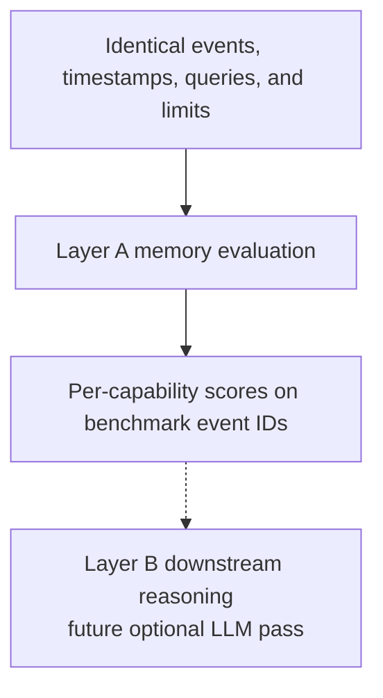

# Benchmark methodology

CogKuraBench evaluates memory systems in two layers:

## Layer A — memory evaluation (0.2.0)

No LLM required. Measures evidence retrieval, ranking, temporal correctness, updates, forgetting, working-memory selection, learning, metamemory, competition diagnostics, transient behavioural interference, and persistent inhibition where supported. Primary top-K metrics count ranked `RetrievedItem` groups. Competition diagnostics (0.3.4+) measure relationship detection; transient interference (0.3.5, fixture v2 in 0.3.7) measures bounded suppression via the `cogkura-interference` profile. Persistent inhibition (0.3.6) measures explicit use, scoped traces, and later recovery via `cogkura-inhibition`. `persistent_inhibition_v1` is the controlled fixture. `persistent_inhibition_software_v1` and `persistent_inhibition_customer_v1` (0.3.8) are longer stateful workloads scored with the same capability. Source authority (0.3.9) scores durable semantic admission on `source_authority_v1`. Authoritative correction (0.3.10) scores replacement, withdrawal, and historical retrieval on `authoritative_corrections_v1`. Retrieval alone does not count as use.

## Layer B — downstream reasoning (future)

Optional LLM evaluation using identical retrieved context across backends.

## Principles

- All backends receive identical events, timestamps, queries, and limits.
- Ground truth is checked into the repository and versioned.
- Expected evidence refers to benchmark event IDs, not backend-internal IDs.
- No single benchmark score: capability scores are reported separately.

## Source assessment (0.3.11 candidate)

`source_aware_metamemory_v1` separately scores exact inventory and source evidence.
It does not score truth, trust rankings or an application's abstention policy.
Missing locators and missing exact revisions differ; episodic relation coverage
can be not applicable; independence stays unknown. Frozen retrieval scoring and
all earlier fixture ground truth are unchanged.

The independent release validator compares 393 frozen queries and explicit uses
against 0.18.2 with controlled standard-library UUID allocation and hash seed,
then pairs diagnostics off/on. Ordinary random-ID observations are retained as
limitations, not silently canonicalised away. PostgreSQL is actually exercised;
strict capped-prefix attribution currently differs and blocks full validation.
